# Práctico 3 | Análisis de vulnerabilidades web y API

**Desarrollo Seguro de Software**

**Aplicaciones utilizadas:** OWASP Juice Shop y OWASP crAPI  
**Herramientas:** Kali Linux, Docker y Firefox Developer Tools

## 1. Introducción

El objetivo de este práctico fue analizar dos aplicaciones diseñadas para realizar pruebas de seguridad: Juice Shop y crAPI.

Seleccioné diez desafíos, cinco de cada aplicación. Para resolverlos utilicé principalmente la pestaña Network de Firefox, que permite observar las solicitudes HTTP y modificarlas mediante la opción *Edit and Resend*.

A continuación, presento las pruebas realizadas, los resultados obtenidos y las medidas que permitirían evitar las vulnerabilidades encontradas.

---

## 2. Pruebas realizadas en OWASP Juice Shop

### J1. Zero Stars

**¿Qué se intentó conseguir?**

Enviar una valoración de cero estrellas, aunque el formulario de la tienda solamente permite seleccionar entre una y cinco.

**Procedimiento**

Primero envié una valoración normal de una estrella desde Customer Feedback. Después busqué la solicitud `POST /api/Feedbacks/` en Network.

Utilicé *Edit and Resend* para cambiar el valor de `rating` de `1` a `0`, sin modificar los demás datos del formulario.

**Lo que comprobé**

La API respondió `201 Created` y registró la valoración de cero estrellas. Juice Shop también mostró que el desafío había sido superado.

**Análisis de seguridad**

- **Falla:** la restricción de calificaciones no se controla correctamente en el servidor.
- **OWASP Top 10 2021:** A04 – Insecure Design.
- **Corrección:** validar que `rating` sea un entero entre 1 y 5 antes de guardar la valoración.

---

### J2. Login Admin

**¿Qué se intentó conseguir?**

Acceder a la cuenta del administrador sin conocer su contraseña.

**Procedimiento**

Desde la pantalla de inicio de sesión, ingresé este valor en el correo electrónico:

`admin@juice-sh.op'--`

En la contraseña coloqué un valor de prueba. La secuencia `'--` permitió alterar la consulta SQL e ignorar la comprobación de la contraseña.

**Lo que comprobé**

La solicitud de inicio de sesión respondió `200 OK` y la aplicación confirmó el desafío *Login Admin*.

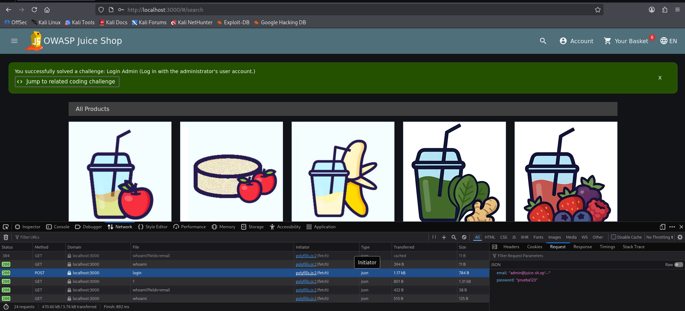

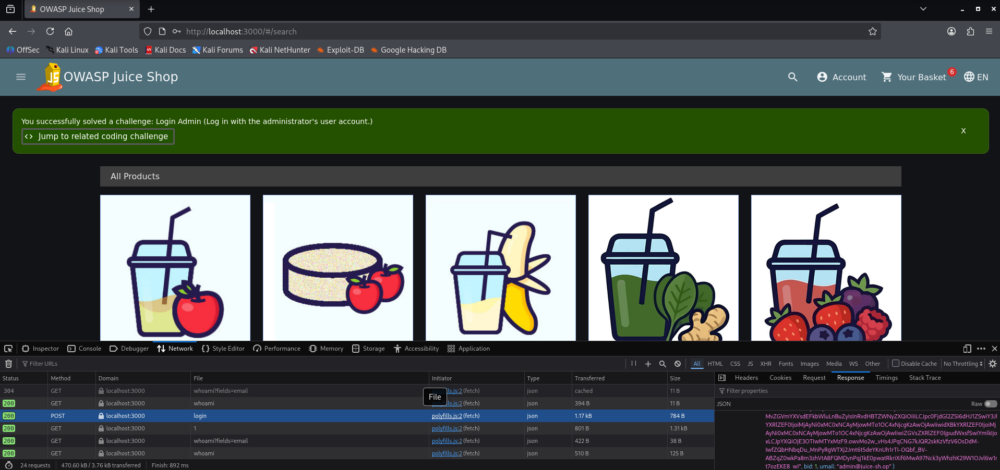

**Análisis de seguridad**

- **Falla:** SQL Injection en el formulario de autenticación.
- **OWASP Top 10 2021:** A03 – Injection.
- **Corrección:** utilizar consultas SQL parametrizadas para separar los datos ingresados de las instrucciones de la consulta.

---

### J4. Admin Registration

**¿Qué se intentó conseguir?**

Crear un usuario con permisos de administrador, aun cuando el registro está pensado para cuentas normales.

**Procedimiento**

Registré primero un usuario común y localicé la solicitud `POST /api/Users/`.

Luego utilicé *Edit and Resend* para cambiar el correo y agregar al cuerpo JSON el campo:

`"role":"admin"`

**Lo que comprobé**

El servidor respondió `201 Created` y Juice Shop confirmó que se había completado *Admin Registration*.

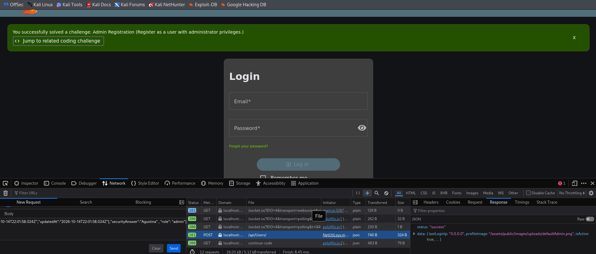

**Análisis de seguridad**

- **Falla:** Mass Assignment, porque el servidor acepta un campo sensible proporcionado por el usuario.
- **OWASP Top 10 2021:** A01 – Broken Access Control.
- **Corrección:** establecer los roles exclusivamente desde el servidor, sin permitir que se indiquen durante el registro público.

---

### J6. View Basket

**¿Qué se intentó conseguir?**

Consultar el carrito de compras de otra cuenta.

**Procedimiento**

Inicié sesión con un usuario normal y entré a mi carrito. Desde Network identifiqué la solicitud:

`GET /rest/basket/6`

El número `6` correspondía a mi carrito. Con *Edit and Resend* cambié ese identificador por `1`, manteniendo la misma sesión.

**Lo que comprobé**

El servidor respondió `200 OK` y permitió consultar un carrito que no pertenecía a mi usuario. Además, Juice Shop confirmó *View Basket*.

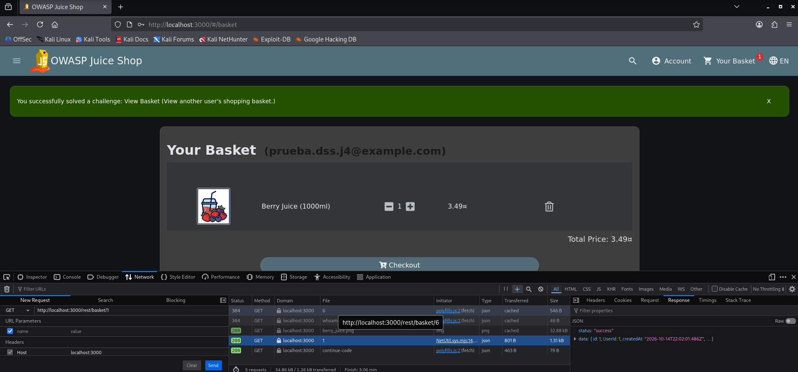

**Análisis de seguridad**

- **Falla:** IDOR, acceso a un recurso ajeno mediante la modificación de su identificador.
- **OWASP Top 10 2021:** A01 – Broken Access Control.
- **Corrección:** comprobar la propiedad del carrito en cada solicitud, sin confiar únicamente en el identificador enviado.

---

### J7. Christmas Special

**¿Qué se intentó conseguir?**

Comprar un producto navideño de 2014 que ya no estaba disponible en el catálogo.

**Procedimiento**

Utilicé la siguiente búsqueda:

`/rest/products/search?q='))--`

La respuesta permitió encontrar *Christmas Super-Surprise-Box (2014 Edition)*, cuyo identificador era `10` y que tenía un valor en `deletedAt`.

Después capturé una solicitud `POST /api/BasketItems/` correspondiente a un producto disponible y cambié `ProductId` por `10`.

Finalmente, entré al carrito y completé la compra.

**Lo que comprobé**

El producto retirado pudo agregarse al carrito y comprarse. La aplicación confirmó el desafío *Christmas Special*.

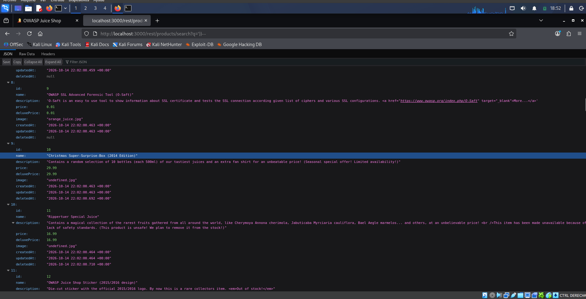

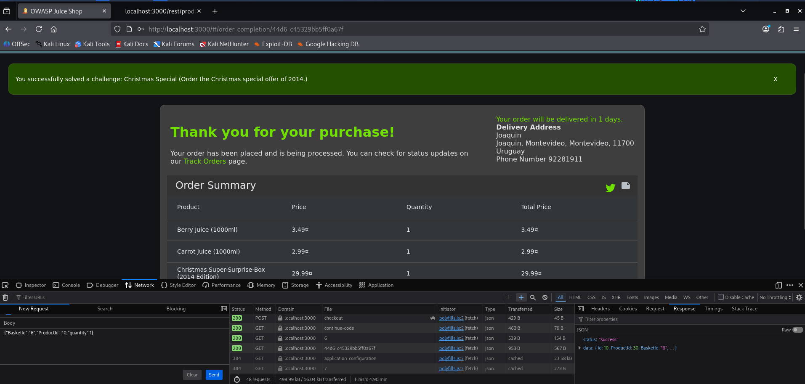

**Análisis de seguridad**

- **Fallas:** SQL Injection en la búsqueda y falta de validación de productos disponibles.
- **OWASP Top 10 2021:** A03 – Injection y A04 – Insecure Design.
- **Corrección:** parametrizar las consultas SQL y verificar que los productos estén activos tanto al agregarlos al carrito como al confirmar la compra.

---

## 3. Pruebas realizadas en OWASP crAPI

### C1. Find Another User's Vehicle Location

**¿Qué se intentó conseguir?**

Obtener información sobre la ubicación de un vehículo de otro usuario.

**Procedimiento**

Primero identifiqué cómo crAPI consultaba la ubicación de mi propio vehículo mediante una solicitud GET.

Luego entré a Community, donde encontré el campo `author.vehicleId` correspondiente al vehículo del usuario Robot.

Reutilicé la solicitud de ubicación y reemplacé el identificador del vehículo por el de Robot, manteniendo mi propia sesión.

**Lo que comprobé**

La API respondió `200 OK` y devolvió coordenadas GPS y datos de un vehículo que no me pertenecía.

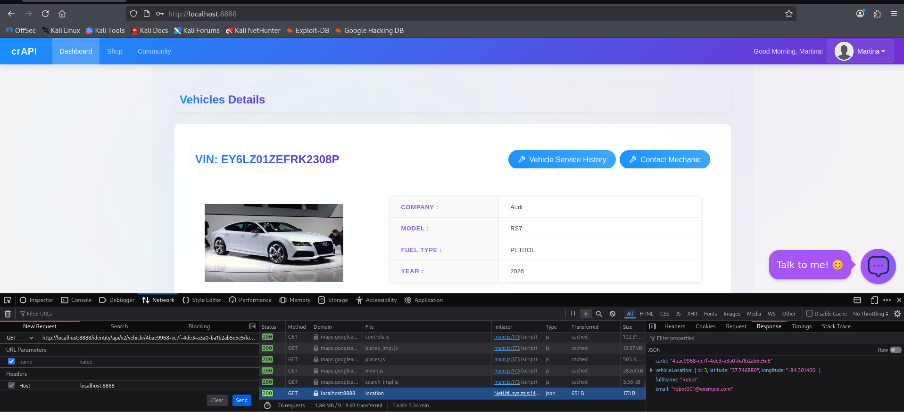

**Análisis de seguridad**

- **Falla:** BOLA (Broken Object Level Authorization).
- **OWASP API Security Top 10 2023:** API1 – Broken Object Level Authorization.
- **Corrección:** verificar que el usuario autenticado esté autorizado a acceder al vehículo solicitado.

---

### C3. Get an Item for Free

**¿Qué se intentó conseguir?**

Alterar la lógica de compra para registrar un artículo sin pagar su importe normalmente.

**Procedimiento**

En Shop realicé una compra normal del producto Seat, cuyo precio era de $10.

Capturé `POST /workshop/api/shop/orders` y utilicé *Edit and Resend* para enviar:

`{"product_id":1,"quantity":-1}`

**Lo que comprobé**

La solicitud fue aceptada con `200 OK` y en Past Orders apareció un pedido de Seat con cantidad negativa y total de `-$10`.

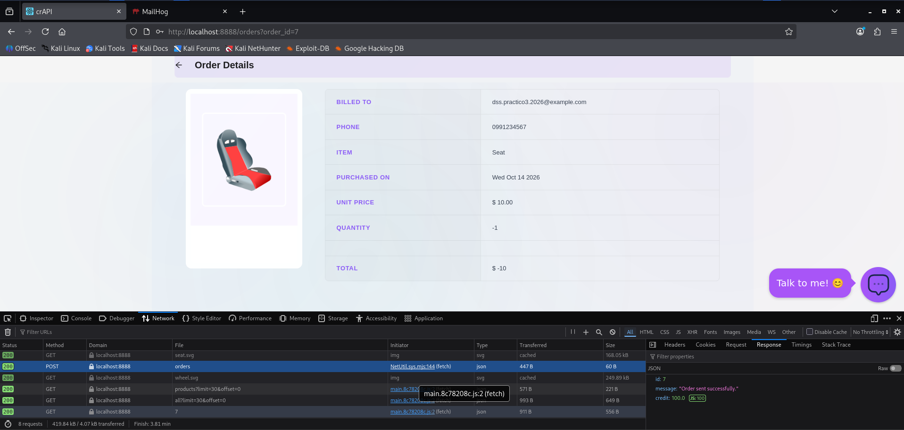

**Análisis de seguridad**

- **Falla:** la API procesa cantidades negativas sin validar las reglas de compra.
- **OWASP Top 10 2021:** A04 – Insecure Design.
- **Corrección:** aceptar solamente cantidades enteras positivas y verificar los importes antes de generar pedidos.

**Observación:** esta prueba utiliza una compra con cantidad negativa, en lugar del flujo de devolución mencionado en la consigna. Demuestra que puede alterarse el importe del pedido, aunque no prueba una entrega física del producto.

---

### C4. Increase Balance by $1,000 or More

**¿Qué se intentó conseguir?**

Aumentar el saldo de la cuenta en al menos $1.000.

**Procedimiento**

Antes de comenzar, comprobé que mi saldo era de **$100**.

Después realicé una compra normal de Seat por $10, quedando con $90, y capturé nuevamente la solicitud de compra.

Con *Edit and Resend* envié:

`{"product_id":1,"quantity":-101}`

Como el precio unitario era de $10, la cantidad negativa generó un importe de `-$1.010`, que el sistema terminó acreditando.

**Lo que comprobé**

El saldo final fue de **$1.100**.

Cálculo de la operación:

`$100 - $10 + $1.010 = $1.100`

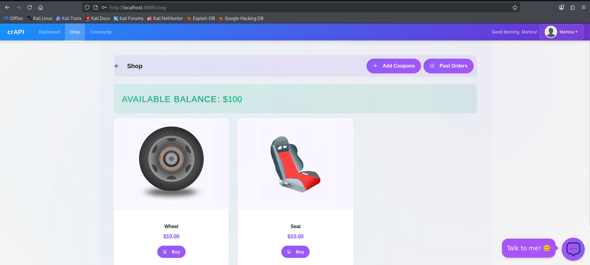

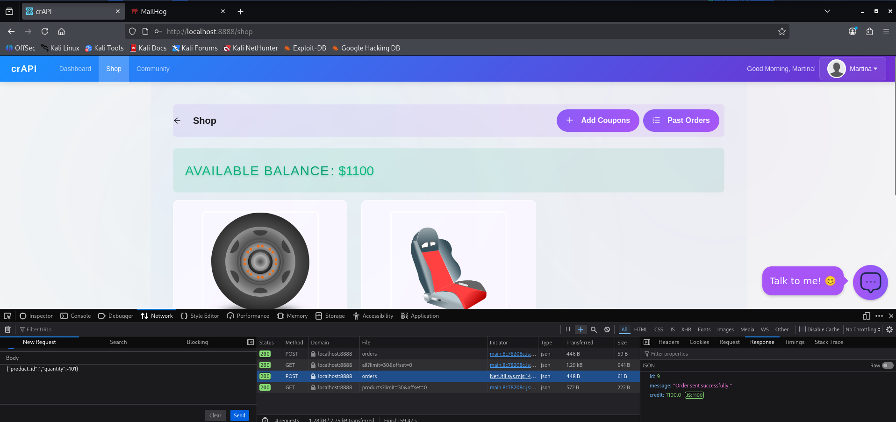

**Análisis de seguridad**

- **Falla:** el cálculo del saldo admite importes negativos derivados de una compra.
- **OWASP Top 10 2021:** A04 – Insecure Design.
- **Corrección:** validar las cantidades e importes en el servidor antes de modificar el saldo.

---

### C5. Server-Side Request Forgery (SSRF)

**¿Qué se intentó conseguir?**

Hacer que el servidor de crAPI enviara una solicitud HTTP a una página externa elegida por mí.

**Procedimiento**

Ingresé a Contact Mechanic y envié un reporte normal.

En Network identifiqué `POST contact_mechanic`. La solicitud incluía el parámetro `mechanic_api`, que indicaba a qué servicio debía enviarse el reporte.

Con *Edit and Resend* reemplacé su valor por:

`https://www.google.com`

Luego reenvié la solicitud sin modificar los demás parámetros.

**Lo que comprobé**

La respuesta fue `200 OK` y contenía HTML de Google dentro de `response_from_mechanic_api`.

Esto indicó que crAPI había consultado el destino indicado en lugar de limitarse al servicio del mecánico.

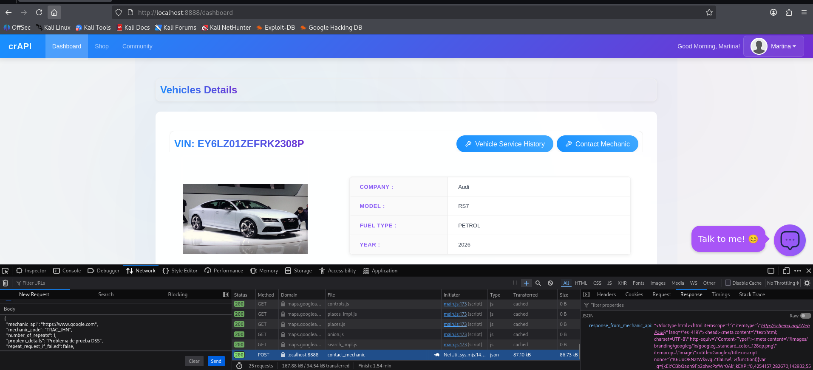

**Análisis de seguridad**

- **Falla:** SSRF (Server-Side Request Forgery).
- **OWASP API Security Top 10 2023:** API7 – Server Side Request Forgery.
- **Corrección:** permitir solamente direcciones de servicios autorizados y bloquear destinos no permitidos.

---

### C6. NoSQL Injection

**¿Qué se intentó conseguir?**

Descubrir un cupón válido sin conocer previamente su código y comprobar que pudiera utilizarse.

**Procedimiento**

En la sección Add Coupons envié primero un código inventado que fue rechazado.

Después capturé `POST validate-coupon` y utilicé *Edit and Resend* para reemplazar el contenido por:

`{"coupon_code":{"$ne":null}}`

El operador `$ne` significa «distinto de» y permitió obtener un cupón sin especificar directamente su código.

**Lo que comprobé**

El servidor devolvió el cupón `TRAC075`, por un importe de $75.

Lo introduje posteriormente en el formulario normal y la aplicación mostró *Coupon applied*. El saldo aumentó de **$1.100 a $1.175**.

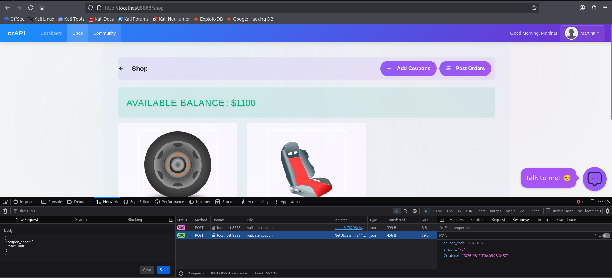

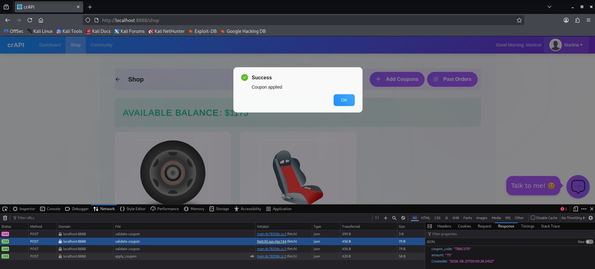

**Análisis de seguridad**

- **Falla:** NoSQL Injection por aceptar operadores de consulta enviados desde el cliente.
- **OWASP API Security Top 10 2019:** API8 – Injection.
- **Corrección:** exigir que `coupon_code` sea un texto válido y rechazar objetos u operadores que puedan modificar la consulta.

---

## 4. Conclusión

Los ejercicios permitieron observar que muchas vulnerabilidades aparecen cuando el servidor confía demasiado en los datos enviados desde el navegador.

En Juice Shop se encontraron problemas de autenticación, autorización y disponibilidad de productos. En crAPI se identificaron accesos no autorizados a información, errores de lógica de negocio y solicitudes manipuladas.

La principal conclusión es que **las restricciones de la interfaz no son suficientes para proteger una aplicación**. El servidor debe validar los datos, comprobar los permisos y aplicar correctamente las reglas del sistema.

Todas las pruebas fueron realizadas en aplicaciones vulnerables de laboratorio, y las capturas se incluyen en la carpeta `evidencias/`.
